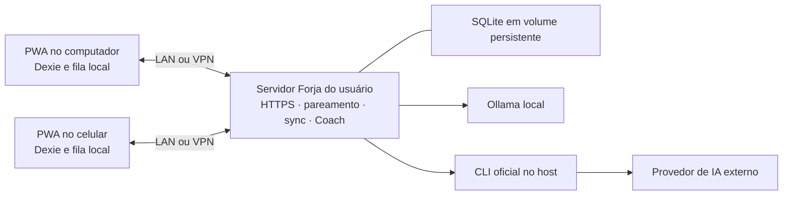

# SDD · Arquitetura proposta

## Importação fiel compartilhada — 20/11/2026

O modo local `port` usa o mesmo `PortablePlanImport` do modal no Perfil. Lê JSON, mostra a prescrição e agenda somente os dias escolhidos, sem provider nem reprogramação. A escrita é transacional e gera a fila de sync pelo repositório. [Contrato técnico e aceite](../dados-portabilidade/importacao-json.md). A conexão de IA continua necessária apenas para gerar/revisar com IA.

Versão de implementação · 15/11/2026. Use o [TRD](TRD.md) para os requisitos do piloto.

O servidor em `apps/server` usa módulos HTTP e SQLite do Node.js 24. A PWA e a API compartilham a origem, e a API valida a origem das mutações. A chave de dono é gerada na pasta de dados e recuperada no terminal com `pnpm self-host:admin`. O dono aprova convites, cada aparelho tem uma sessão revogável e o QR usa um segredo no fragmento da URL.

Dexie grava as mudanças e a fila juntas em `db/sync-write.ts`. O cliente mantém a versão conhecida por entidade, preserva escritas locais ao receber mudanças e confirma o cursor junto à aplicação dos dados. O servidor compara a versão de base e persiste a operação, os marcadores de exclusão e o feed em uma transação SQLite. O feed preserva os limites de cada lote. As rotinas excluídas liberam a agenda correspondente e preservam o nome histórico.

A revisão aplica a troca no repositório local por comparação da rotina atual com a versão exibida. A alteração entra na fila de sync e o registro de desfazer fica no aparelho. O Assistente usa Ollama ou Codex CLI. A rota de montagem envia objetivo, foco, tempo e exercícios elegíveis. A saída validada se torna uma rotina no Dexie apenas após a confirmação. O Codex CLI mantém uma prova de terminal com dados sintéticos. [SDD dos provedores](../coach-ai-provider/design.md). [Instalação e backups](../../../README.md#sincronizar-pc-e-celular).

## Componentes e fronteiras

- Cliente local grava e lê Dexie. O repositório é a fronteira de mutação. Zustand mantém rascunho e timers por aparelho. Um único executor de sync por banco/aparelho reduz disputas entre abas; a idempotência do servidor é a proteção final.
- A implantação de referência serve o build web e `/api/v1` na mesma origem, atrás de TLS. A imagem em contêiner pode simplificar PWA e sync. A CLI só estará disponível se instalada no mesmo ambiente do executor ou em um conector local isolado deliberadamente configurado. Para a prova CLI, rodar o processo host sob usuário não privilegiado pode ser mais simples do que montar credenciais do host em contêiner.
- Entre origens diferentes, o caminho inicial recomendado para migrar dados é **Exportar backup** na origem antiga → **Importar para sincronizar** na origem nova. Importação de dados existentes pede prévia antes de enviar. Uma transferência entre origens é uma jornada de migração, não um efeito implícito do pareamento.

## Estado persistido proposto

| No cliente | No servidor |
| --- | --- |
| Tabelas Dexie atuais; metadados de sync por perfil/entidade; fila; conflitos retidos; cursor confirmado; identificação da instalação. Sessão autenticada em cookie gerido pelo navegador na topologia de mesma origem. | Instalação/perfil, aparelhos e sessões revogáveis, convites, entidades com versão, sequência do feed, registros de idempotência e alterações aplicadas pelo Coach. |

Usar IDs e datas existentes. Dados de treino constituem a fonte dos gráficos e da progressão. O servidor conserva o nome histórico e limpa referências da agenda na mesma mudança de exclusão. IDs já removidos permanecem reservados pelo tombstone. O cliente usa uma base sincronizada mais as mutações ainda pendentes, ou uma estratégia equivalente que preserve as alterações locais ao receber mudanças remotas.

## Contratos sugeridos

| Rota | Operação |
| --- | --- |
| `POST /api/v1/pairings` | Admin cria convite e recebe QR, código e expiração. |
| `POST /api/v1/pairings/claim` | Aparelho pede conexão com QR/código, nome informado e id de tentativa. Devolve identificador opaco para aguardar decisão. |
| `POST /api/v1/pairings/{id}/approve`, `DELETE /api/v1/pairings/{id}` | Admin aprova ou cancela. A mesma tentativa só pode ser aprovada uma vez. |
| `POST /api/v1/pairings/exchange` | Aparelho prova posse da tentativa aprovada, recebe cookie/sessão vinculada e troca o identificador uma vez. Limitar polling ou oferecer canal de estado equivalente. |
| `GET /api/v1/devices`, `DELETE /api/v1/devices/{id}` | Aparelhos vinculados. Revogação administrativa invalida sessão e futuras chamadas. |
| `GET /api/v1/sync/changes?after=…` | Página ordenada de alterações incluindo deletes. Retorna cursor da página e indicação de mais eventos. Na primeira carga, utilizar paginação consistente ou snapshot com marca de corte seguida pelo feed. |
| `POST /api/v1/sync/push` | Lote limitado de mutações, com retorno individual de aceite, reaplicação idempotente, validação ou conflito. Um grupo indivisível tem uma confirmação. Autenticação determina instalação/aparelho. |
| `GET /api/v1/coach/providers`, `POST /api/v1/coach/test` | Mostra disponibilidade, nome e destino. O teste utiliza entrada sintética. |
| `POST /api/v1/coach/reviews` | Solicita revisão com payload aprovado. Retorna resultado validado ou identificador de trabalho, conforme o runtime escolhido. |
| Aplicar e desfazer | Transação local do repositório com comparação de versão e gravação da alteração na fila. |

Envelope sugerido por mutação. `opId`, `type`, `entityId`, `baseVersion`, `action`, `payload` e `protocolVersion`. Uma operação composta inclui versão esperada das entidades relevantes ou uma regra equivalente no servidor. O cursor é opaco para o cliente. Usar transação única para dados, deduplicação e append do feed. Aceitar repetição com o mesmo conteúdo e rejeitar reutilização do identificador com outro conteúdo. HTTP e códigos de domínio devem diferenciar pelo menos `CONFLICT`, `ENTITY_DELETED`, `PAIRING_EXPIRED`, `DEVICE_REVOKED`, `UPDATE_REQUIRED` e `PROVIDER_UNAVAILABLE`.

## Sequências e recuperação

1. **Parear.** Adm. cria convite → celular solicita → admin vê o nome e confirma → celular troca a prova por sessão. Cancelar/expirar não deixa autorização. Desconectar um aparelho conserva dados locais e impede novas requisições autorizadas; sincronizar com outra instalação exige decisão explícita de importação.
2. **Primeira sincronização.** Inspecionar os dois conjuntos e mostrar o plano de importação. Em instalação vazia, enviar entidades locais preservando IDs; em instalação com dados, deduplicar ID de conteúdo idêntico e sinalizar colisões. A migração concluída recebe marca persistente. Um retry reaproveita o identificador de migração e suas operações.
3. **Sync normal.** Registrar localmente e enfileirar juntos. Ao reconectar, fazer pull/push/pull ou protocolo equivalente. Aplicar evento e novo cursor na mesma transação Dexie. Repetir do cursor confirmado após crash. Manter dados e fila em erro de conexão, versão, revogação ou conflito. A instalação conserva o feed. Se o servidor voltar a um cursor anterior após restauração, o aparelho oferece backup e novo vínculo explícito.
4. **Conflito.** Alterações em entidades diferentes convergem. Mudanças na mesma rotina ou no mesmo log exigem comparação entre a versão que chegou e a local, com escolha explícita. Com exclusão remota, preservar o trabalho local para copiar ou salvar como nova rotina com novo ID. Em qualquer opção, atualizar a fila e a versão de base para a decisão escolhida.
5. **Exclusão.** Excluir rotina ou plano retira agendamentos vinculados e preserva os treinos. O servidor também protege contra write atrasado que aponte para rotina excluída. Concluir sessão cujo plano foi removido ainda é válido com snapshot histórico.
6. **Revogação e indisponibilidade.** Sessão revogada impede sync e IA. Servidor desligado mantém alerta de pendência e treino local. Parear novamente requer aprovação. Exportação do backup local segue disponível.

## Contrato de revisão semanal

Calcular métricas no app usando histórico e progressão já existentes. Usar sete datas locais encerradas na data selecionada, com política explícita de fuso da instalação para comparação entre aparelhos. Payload de entrada usa agregados, IDs estáveis e equipamento selecionado, com revisão pelo usuário. Trechos de notas pessoais, peso, medidas e histórico bruto ficam fora do envio no piloto. Apresentar prévia no mesmo formato para provedores internos ou externos. Avisar quando a prévia pode estar incompleta devido a pendências de sync.

Saída estruturada com `summary` e `suggestions[]`. No piloto, sugestões aplicáveis usam somente `replaceExercise`, ID da rotina, alvo identificado sem ambiguidade e referência ao exercício substituto. Verificar identidade da instância de exercício na rotina (o mesmo exercício pode se repetir), modalidade, equipamento e compatibilidade da configuração. Se a política de progressão da substituição for incompatível, apresentar a proposta como indisponível e explicar. Não transferir carga anterior entre exercícios diferentes. A validação renderiza texto como texto e rejeita payloads inválidos ou referências inexistentes.

A alteração só age após confirmação, revalidando a versão atual e guardando inversa ou snapshot e resultado numa transação com evento de sync. A sugestão perde validade quando o alvo mudou. Desfazer também valida versão e gera uma mudança sincronizável. A IA não recebe acesso a shell do usuário, banco, credenciais de outros provedores ou escrita de treino. A ausência de resposta libera o usuário para continuar usando o app.

## Treino e consulta de sessões

- **Treino Guiado.** Montar o painel do exercício a partir de `Media`, `MuscleMap` e da mesma classificação usada na Biblioteca. Vincular a ação ao exercício atual e manter inputs, descanso e rascunho sob o fluxo de sessão já existente. A URL do YouTube é derivada no cliente.
- **Histórico.** Manter `WorkoutCard` como unidade de expansão e a data como agrupamento. O período civil limita a lista antes do agrupamento. Um link direto a um treino deve encontrar a sessão mesmo quando ela estiver fora do filtro padrão. O resumo e o mapa podem reutilizar os cálculos de `lib/stats.ts` e consultam a sessão exibida. Os detalhes usam as séries registradas. Para logs de exercícios ausentes do catálogo, exibir os dados que o log possui e sinalizar a cobertura parcial, sem exigir migração de backups antigos.

## Decisões delegadas ao Claude

Framework HTTP, driver SQLite, autenticação inicial, cookie versus alternativa local, estratégia cliente de base + fila, representação de conflitos, transporte de atualização e formato da prova CLI podem mudar. Registre o custo de migração, a operação de backup, o teste demonstrável e o efeito na configuração self-hosted. Conferir em particular se um token opaco de troca é a melhor opção para o bootstrap de pareamento e se é preferível aplicar propostas no servidor ou pelo repositório local com CAS na sincronização.
