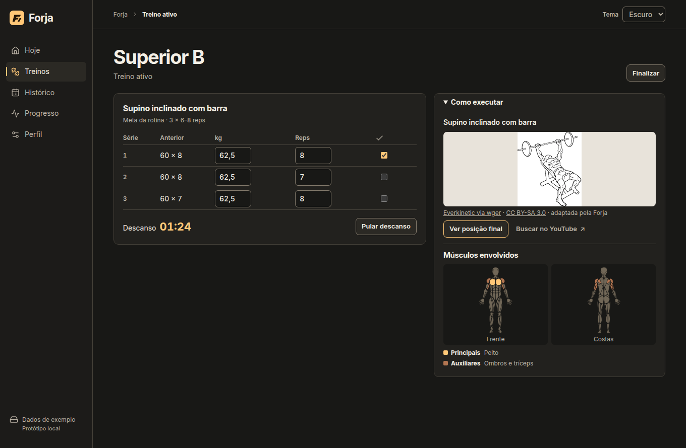
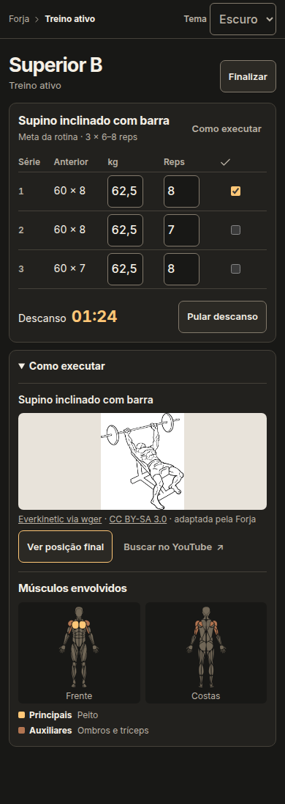
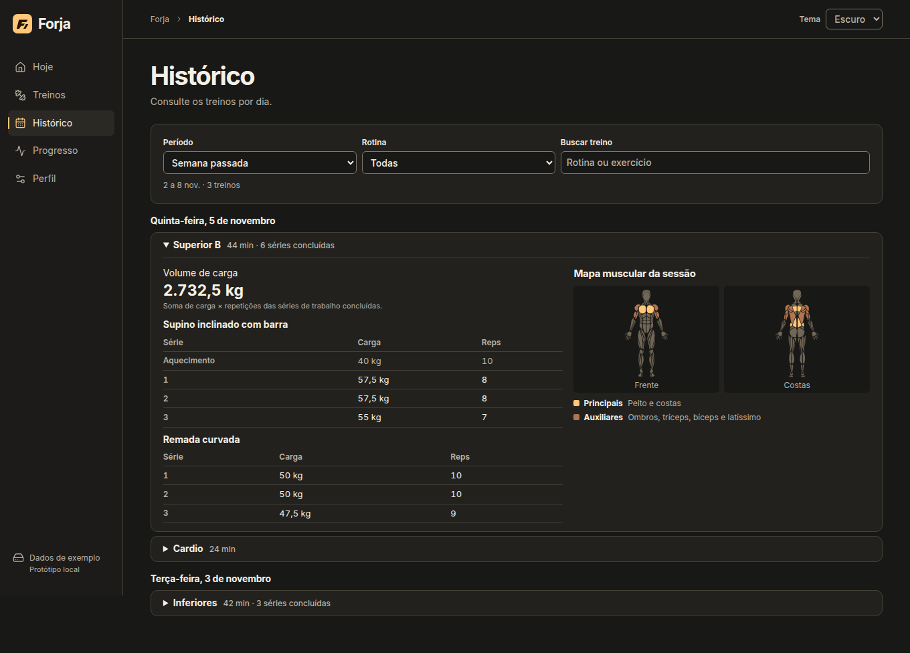
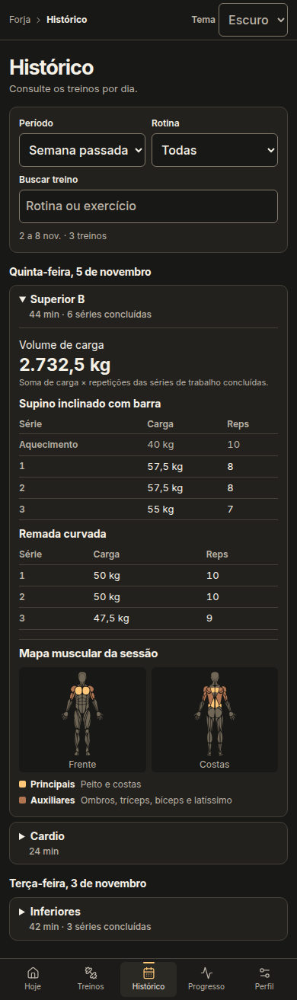

# Protótipo responsivo · Forja

Abra [index.html](index.html) em um navegador. As oito telas usam dados fictícios e podem ser lidas offline, sem build ou CDN. Para ler a intenção dos componentes e as diferenças entre demonstração e implementação, consulte o [guia UX/UI](../UX-UI.md).

- [Hoje](index.html#hoje) e [Progresso](index.html#progresso) demonstram linha de carga, período e exercício, leitura dos pontos por botão ou toque e tabela de valores.
- [Editor de rotina](index.html#rotina) demonstra os campos compactos. Em [Treino ativo](index.html#treino), abra **Como executar** para trocar a posição da demonstração, ver o atlas e conferir a busca pelo nome no YouTube.
- No [Histórico](index.html#historico), selecione **Semana passada** e abra **Superior B** em 5 de novembro para consultar as séries, o aquecimento, o volume e o mapa da sessão. Há duas sessões nesse dia.
- [Perfil](index.html#perfil), [Dispositivos](index.html#dispositivos) e [Assistente](index.html#assistente) demonstram ajustes em seções. Em **Parear aparelho**, abra **Simular entrada pelo celular**. Use o código de exemplo mostrado no convite.
- No topo, **Tema** alterna claro e escuro. Ao estreitar a janela, o layout empilha as seções e os alvos de toque aumentam.

A demonstração usa HTML, CSS, JavaScript e Canvas. Pareamento, gravação da rotina, provedor e revisão são simulados. Os dados foram montados para a demonstração e ficam em memória. O QR, a sincronização, os provedores e as verificações da implementação seguem o SDD. O app já tem linhas e cálculos em Progresso. O Claude pode reutilizá-los e escolher como renderizar os novos gráficos.

Os ícones de interface vêm do `lucide-react` instalado na Forja e foram incorporados ao HTML para o protótipo abrir offline. [Licenças](LICENSE-lucide.txt) · [Lucide e Feather](https://lucide.dev/guide/comparison).

## Capturas

| Fluxo | Desktop | Celular |
| --- | --- | --- |
| Treino ativo · Como executar |  |  |
| Histórico · Semana passada |  |  |

Capturas do protótipo renderizado no Brave, com dados de exemplo. A demonstração de supino usa dois quadros adaptados de Everkinetic via wger, sob CC BY-SA 3.0. A geometria do atlas foi reutilizada de MuscleMap. [Posição inicial](https://wger.de/api/v2/exerciseimage/129/) · [Posição final](https://wger.de/api/v2/exerciseimage/130/) · [CC BY-SA 3.0](https://creativecommons.org/licenses/by-sa/3.0/) · [Licença do atlas](assets/LICENSE-musclemap.txt).
