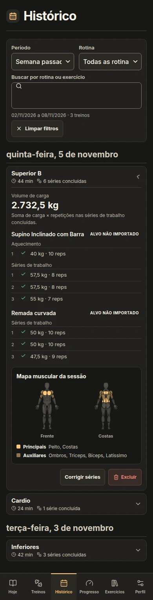
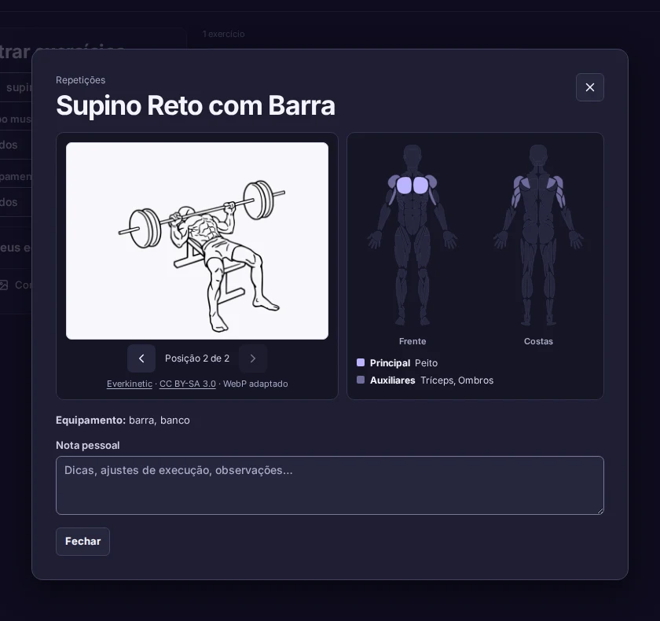

<p align="center">
  
</p>

<h1 align="center">Seu próximo treino começa aqui.</h1>

<p align="center">
  Planeje a semana, registre cada série e saiba o que tentar na próxima sessão.
  <br />
  Um diário de treino de força instalável. Treine offline e sincronize pela sua própria instalação.
</p>

<p align="center">
  <a href="#telas">Ver o app</a> · <a href="#rodar-localmente">Rodar localmente</a> ·
  <a href="#instalar-como-app">Instalar como app</a> · <a href="#sincronizar-pc-e-celular">Sincronizar</a> · <a href="#seus-dados">Fazer backup</a>
</p>

<a name="screenshots"></a>

## Telas

[](assets/screenshots/hoje-desktop.webp)

<table>
  <tr>
    <th scope="col">Hoje no celular</th>
    <th scope="col">Treino guiado no celular</th>
    <th scope="col">Histórico no celular</th>
  </tr>
  <tr>
    <td><a href="assets/screenshots/hoje.webp"></a></td>
    <td><a href="assets/screenshots/treino-mobile.webp"></a></td>
    <td><a href="assets/screenshots/historico-mobile.webp"></a></td>
  </tr>
</table>

<details>
  <summary><strong>Ver mais telas do desktop</strong></summary>
  <br />
  <table>
    <tr><th scope="col">Histórico</th><th scope="col">Progresso</th></tr>
    <tr>
      <td><a href="assets/screenshots/historico.webp"></a></td>
      <td><a href="assets/screenshots/progresso.webp"></a></td>
    </tr>
    <tr><th scope="col">Atlas de exercícios</th><th scope="col">Treino guiado</th></tr>
    <tr>
      <td><a href="assets/screenshots/atlas.webp"></a></td>
      <td><a href="assets/screenshots/treino-guiado.webp"></a></td>
    </tr>
  </table>
</details>

<details>
  <summary><strong>Ver sincronização, Assistente e evolução de carga</strong></summary>
  <br />
  <table>
    <tr><th scope="col">Pareamento no PC</th><th scope="col">Dispositivos no celular</th></tr>
    <tr>
      <td><a href="assets/screenshots/dispositivos-desktop.webp"></a></td>
      <td><a href="assets/screenshots/dispositivos-mobile.webp"></a></td>
    </tr>
    <tr><th scope="col">Revisão semanal</th><th scope="col">Evolução de carga</th></tr>
    <tr>
      <td><a href="assets/screenshots/assistente-desktop.webp"></a></td>
      <td><a href="assets/screenshots/evolucao-desktop.webp"></a></td>
    </tr>
  </table>
</details>

<sub>Capturas da aplicação com dados de demonstração. A tela do Assistente usa um provedor simulado.</sub>

## Do primeiro treino ao próximo

| Etapa | O que você faz na Forja |
| --- | --- |
| **Planejar** | Comece com um plano de força em casa, corpo inteiro, superior/inferior ou 5×5. Crie suas rotinas, distribua na semana e ajuste uma data quando precisar. |
| **Treinar** | Siga o roteiro e registre repetições, carga, tempo ou distância. Use cronômetros, superséries e aquecimentos. Em **Como executar**, consulte a demonstração, os músculos principais e auxiliares e a busca no YouTube pelo exercício. |
| **Evoluir** | Veja a próxima meta, o motivo e a evolução da carga por exercício em 4 ou 8 semanas. Acompanhe volume, recordes, esforço e medidas corporais. No **Histórico**, filtre por semana ou por datas e abra uma sessão para ver o mapa muscular, as séries, o aquecimento e corrigir registros. |
| **Encontrar exercícios** | Filtre pelo equipamento que você tem ou pelos músculos envolvidos. Consulte o atlas e as demonstrações disponíveis offline. |

Em **Perfil → Configurações → Cor de acento**, escolha **Âmbar** para usar a paleta grafite e laranja no tema escuro. Durante o treino, o descanso continua contando enquanto você consulta **Como executar**. Os recursos locais do guia funcionam após carregar o app. A busca no YouTube abre outra aba e usa a conexão do aparelho.

Em **Treinos → Minhas rotinas**, o botão **Excluir plano** remove o conjunto criado a partir de um plano pronto. Use a lixeira de uma rotina para removê-la individualmente. Os agendamentos associados são retirados e as sessões já registradas continuam no Histórico.

<details>
  <summary><strong>Como funcionam as regras de progressão</strong></summary>

| Regra | Como a Forja calcula o próximo alvo |
| --- | --- |
| Manual | Usa o último registro como referência. |
| Linear | Sobe a carga após atingir o alvo e pode reduzi-la depois de falhas repetidas. |
| Greyskull LP | Usa as repetições da última série para decidir o incremento. |
| Dupla | Aumenta as repetições dentro da faixa antes de subir a carga. |
| Tempo | Ajusta a meta de duração dos exercícios cronometrados. |
| 5/3/1 | Prescreve séries por percentual e avança o máximo de treino ao concluir o ciclo. |

Aquecimentos ficam no Histórico, fora do cálculo de metas, volume e recordes. Cada sessão guarda o alvo que valia na hora do treino.

</details>

## Rodar localmente

Você precisa de **Git**, **Node.js 24** e **pnpm 10.34.9** ou **12.16.1**. Para instalar a versão usada na verificação em um clone limpo, rode `npm install --global pnpm@10.34.9`.

```sh
git clone https://github.com/rfsants001/forja.git
cd forja
pnpm install --frozen-lockfile
pnpm dev
```

Abra **http://localhost:5577**. Em **Hoje**, selecione **Começar com um plano** para preparar o primeiro treino.

## Instalar como app

Para testar instalação e modo offline, use o build de produção.

```sh
pnpm build
pnpm --filter @forja/web preview --host 127.0.0.1 --port 4173 --strictPort
```

Abra **http://127.0.0.1:4173** e aguarde o carregamento inicial. No navegador compatível, use **Instalar aplicativo** ou **Adicionar à Tela de Início**. Em outro dispositivo, sirva o build por HTTPS para habilitar a PWA.

## Sincronizar PC e celular

A instalação opcional serve a mesma PWA e a API em uma origem e guarda os dados sincronizados em SQLite. Para experimentar no computador, rode:

```sh
pnpm install --frozen-lockfile
pnpm build
pnpm self-host
```

Em outro terminal, rode `pnpm self-host:admin` para obter a chave do dono. Abra **http://127.0.0.1:8787** e entre em **Perfil → Dispositivos → Identificar-se como dono**. Informe a chave, confira os dados dos dois lados em **Revisar dados** e confirme a sincronização.

Para acessar pelo celular, use uma origem HTTPS confiável que os dois aparelhos alcancem na sua rede ou VPN. Configure o endereço antes de instalar a PWA. Com um proxy HTTPS no mesmo computador, use uma configuração como esta.

```sh
FORJA_URL=https://forja.seu-dominio.example \
FORJA_HOST=127.0.0.1 FORJA_PORT=8787 \
FORJA_DATA_DIR=./data/forja FORJA_TIME_ZONE=America/Sao_Paulo \
pnpm self-host
```

Aponte o proxy HTTPS para `127.0.0.1:8787`. Também é possível servir TLS no próprio processo com `FORJA_TLS_CERT` e `FORJA_TLS_KEY`. Use o mesmo `FORJA_DATA_DIR` ao obter a chave do dono. O endereço configurado é o que aparece no QR.

1. No PC, abra **Dispositivos → Parear aparelho**.
2. No celular, abra o QR pela câmera ou acesse o endereço exibido e digite o código.
3. Aprove no PC, revise os dados no celular e confirme. Um treino finalizado sem internet entra na fila e é enviado na reconexão. A tela Dispositivos mostra a última sincronização, as pendências e os conflitos.

Se você já usava a Forja em outro endereço, exporte um backup JSON de lá e importe na nova origem antes de sincronizar. O sync replica rotinas, agenda e exceções, categorias, exercícios personalizados referenciados e treinos concluídos. Medidas, peso corporal, preferências, notas pessoais da biblioteca e a sessão ainda em andamento ficam no aparelho.

Para copiar a instalação inteira, pare o servidor e copie a pasta de dados, incluindo a chave do dono e os arquivos do SQLite. Guarde a cópia em local privado. Restaure com o servidor parado e confira o vínculo dos aparelhos ao voltar. A janela de revisão usa o fuso de `FORJA_TIME_ZONE` ou o fuso do host.

## Assistente local

Com o Ollama e um modelo local instalados no host, abra **Perfil → Assistente de treino**. Use **Atualizar modelos**, teste o modelo e confira o período e os dados que serão usados antes de gerar uma revisão. O endpoint padrão é `http://127.0.0.1:11434`. Use `FORJA_OLLAMA_URL` se a instância estiver em outro endereço administrado por você.

A revisão usa agregados da semana e pode propor trocar um exercício por outro da biblioteca com o mesmo grupo principal e modalidade, conforme o equipamento selecionado em **Exercícios → Meus equipamentos**. Compare a rotina atual com a proposta antes de aplicar. É possível desfazer enquanto a rotina continuar na versão aplicada.

Para a prova opcional do Codex CLI, use um login oficial dedicado em Linux com Bubblewrap e execute `pnpm self-host:codex-probe` com `FORJA_CODEX_HOME` e `FORJA_CODEX_BINARY` apontando para esse perfil e o binário oficial. A prova envia um prompt sintético e valida uma resposta JSON. [Modo não interativo do Codex](https://learn.chatgpt.com/docs/non-interactive-mode).

## Seus dados

Os registros locais ficam no IndexedDB do navegador. Em **Perfil → Seus dados**, exporte um backup JSON pra guardar ou transferir seus treinos. Na restauração, revise a prévia e escolha mesclar os registros ou substituir os dados locais.

Você também pode importar CSVs de **FitNotes**, **Strong** e **Hevy**, importar peso de um XML do **Apple Health** ou compartilhar só o plano semanal em JSON ou PDF.

## Desenvolvimento e créditos

O domínio TypeScript vive em `packages/core`. A PWA React/Vite vive em `apps/web`. O servidor opcional Node.js 24 e SQLite está em `apps/server`. Rode `pnpm test`, `pnpm typecheck` e `pnpm build` antes de enviar uma alteração.

Forja é inspirada no [openGym](https://github.com/DuarteSantos8/openGym). A anatomia vem do [MuscleMap](https://github.com/melihcolpan/MuscleMap) sob MIT. As demonstrações usam imagens do wger e do Wikimedia Commons com [crédito e licença por arquivo](apps/web/public/exercise-media/CREDITS.md). A [documentação de integrações](.specs/codebase/INTEGRATIONS.md) registra as fontes e o status da licença do projeto.
