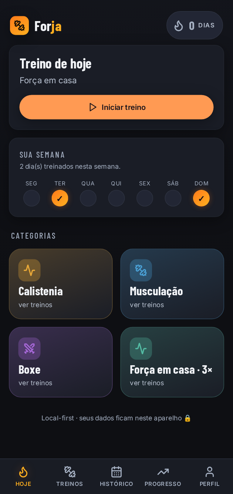
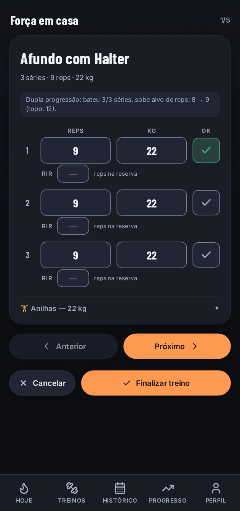
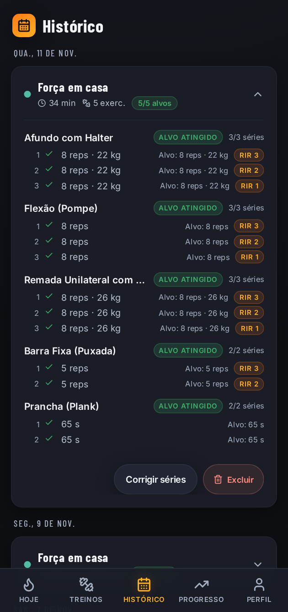
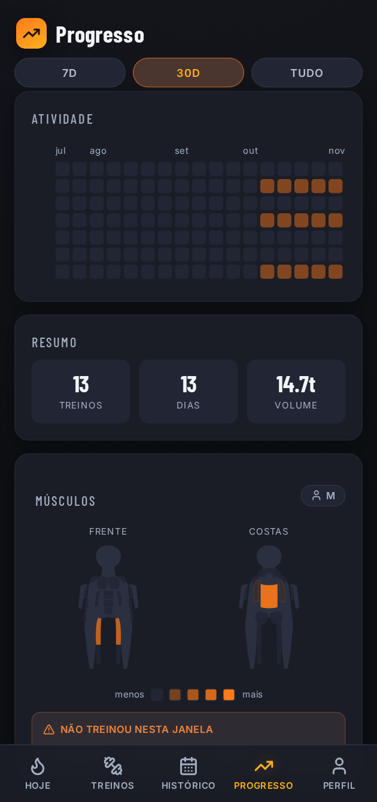

<p align="center">
  
</p>

# Forja

**Forja is a local-first strength training log.** Build a routine, follow it set by set, and see what to try next and why. The guided workout fills in targets from your training history and the progression rule you picked. Your records stay in the browser, and you can export them to move to another device.

Forja is built for people who plan their own strength or calisthenics training, at home or in a gym. It runs as a web app and can be installed as a PWA from a supported browser. The current interface is in Brazilian Portuguese, with English translation in progress.

[See the app](#screenshots) · [Clone and run](#clone-and-run) · [Install as a PWA](#install-as-a-pwa) · [Back up your data](#backups-and-moving-devices)

## Screenshots

Screenshots from the app with demo workouts and measurements.

<table>
  <tr>
    <th scope="col">Today</th>
    <th scope="col">Guided workout</th>
  </tr>
  <tr>
    <td></td>
    <td></td>
  </tr>
  <tr>
    <th scope="col">History</th>
    <th scope="col">Progress</th>
  </tr>
  <tr>
    <td></td>
    <td></td>
  </tr>
</table>

## Your first two workouts

1. **Set up a routine.** On **Hoje**, choose **Começar com um plano**, **Criar rotina**, or **Importar histórico**. The ready-made plans include home strength, full body, upper/lower, and 5×5. **Força em casa · 3×** uses adjustable dumbbells, a pull-up bar and bodyweight exercises.
2. **Schedule it.** In **Treinos**, assign routines to weekdays. Use **Mudar só um dia** to change a single date, or **Treinar agora** to start a routine on demand.
3. **Log what you did.** The guided screen shows the target and its rationale. Enter your actual reps, load, time or cardio metrics, then mark the set complete. It supports supersets, work and rest timers, and optional RIR. You can reload and continue an in-progress workout in the same browser.
4. **Review and return.** In **Histórico**, compare actual sets with their targets and correct recording mistakes with **Corrigir séries**. The next session uses the updated history. **Progresso** shows your activity, muscle coverage, estimated 1RM, effort, and body measurements.

### How progression works

The routine editor lets you pick a rule per exercise. Forja saves the target that was in effect for each workout alongside the actual sets. That keeps older sessions readable after you change the routine.

| Rule | How it sets the next target |
| --- | --- |
| Manual | Uses the last recorded load as a starting point. |
| Linear | Increases the load after a successful session and can reduce it after repeated misses. |
| Greyskull LP | Uses the last set's reps to decide the increase and can reduce the load after a miss. |
| Double progression | Builds reps through a range before increasing the load. |
| Time | Adjusts the duration target for timed exercises. |
| 5/3/1 | Prescribes individual sets from a training max and advances the cycle as you meet the targets. |

If you log reps below the prescribed load, that set does not count as meeting the target. Imported sets with no original prescription can provide a starting reference.

## Clone and run

Use **Git**, **Node.js 24**, and **pnpm 12.16.1** to reproduce the verified setup. If you need pnpm, install it with `npm install --global pnpm@12.16.1`.

```bash
git clone https://github.com/rfsants001/forja.git
cd forja
pnpm install --frozen-lockfile
pnpm dev
```

Open [http://localhost:5577](http://localhost:5577/). If that port is busy, use the URL Vite prints. The first launch initializes a fresh local catalog and settings. No account, database server, or environment variables are required.

### Install as a PWA

Build and preview the production version to try installation and offline use:

```bash
pnpm build
pnpm --filter @forja/web preview --host 127.0.0.1 --port 4173 --strictPort
```

1. Open [http://127.0.0.1:4173](http://127.0.0.1:4173/) and let the first load finish online.
2. In a supported browser, choose **Install app** or **Add to Home Screen**.
3. Open the app again and try navigating or logging a workout offline. The catalog and training screens are cached. Third-party photos and GIFs can be unavailable without a connection.

To host it for another device, serve the contents of `apps/web/dist/` at an HTTPS origin. Configure your static host to serve `index.html` for app routes such as `/treinos` and `/historico`. The browser treats the dev URL, preview URL and deployed URL as separate storage origins.

## Backups and moving devices

In **Perfil → Seus dados**, choose **Exportar backup** and save the JSON outside the browser. This file includes workouts, routines, exercise records, weight, preferences, and body measurements. To restore, open the Forja instance on the destination and select **Importar backup**.

- **Mesclar dados** adds records and updates matching IDs.
- **Substituir dados** replaces the local records covered by the backup after confirmation.
- **Cancelar** closes the restore flow without writing data.

Backup v2 includes body measurements. When you restore a v1 file, measurements already on the destination stay there. Forja stores the active workout draft separately from the completed workout log. Finish the session before exporting it.

Use **Perfil → Compartilhar plano** to send a plan as JSON or print it to PDF without including your workout history or weight. Use **Importar de outro app** for FitNotes, Strong, and Hevy CSV files, or for body weight from an Apple Health XML export.

## Development

| Command | What it does |
| --- | --- |
| `pnpm dev` | Runs the web app in development. |
| `pnpm test` | Runs the domain tests. |
| `pnpm typecheck` | Checks both workspaces. |
| `pnpm build` | Builds the domain and the production PWA. |

`packages/core` contains the TypeScript rules for progression, scheduling, history, PRs and plate calculations. `apps/web` is the React and Vite client. Dexie stores records in IndexedDB, Zustand persists the active session, and a service worker caches the app for offline use.

[Product requirements](.specs/project/PRD.md) · [Architecture](.specs/codebase/ARCHITECTURE.md) · [Roadmap](.specs/project/ROADMAP.md) · [Current state](.specs/project/STATE.md)

## Credits and licensing

Forja is a TypeScript reimplementation inspired by [openGym](https://github.com/alexpcosta/opengym). Exercise metadata and instructions come from [hasaneyldrm/exercises-dataset](https://github.com/hasaneyldrm/exercises-dataset). The exercise photos and GIFs have separate terms from Gym visual. Forja's source license is still to be decided. See the [integration notes](.specs/codebase/INTEGRATIONS.md) for the pinned dataset license and media terms.
