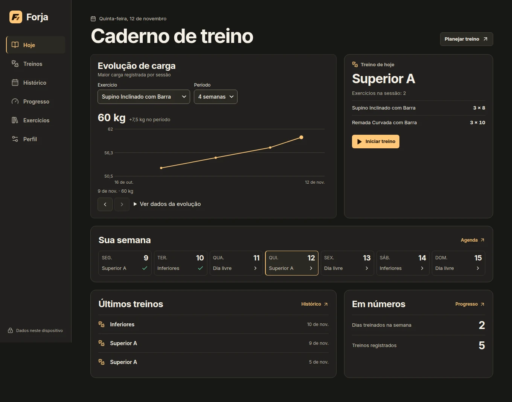
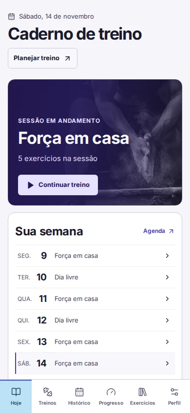
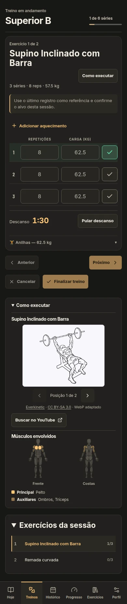
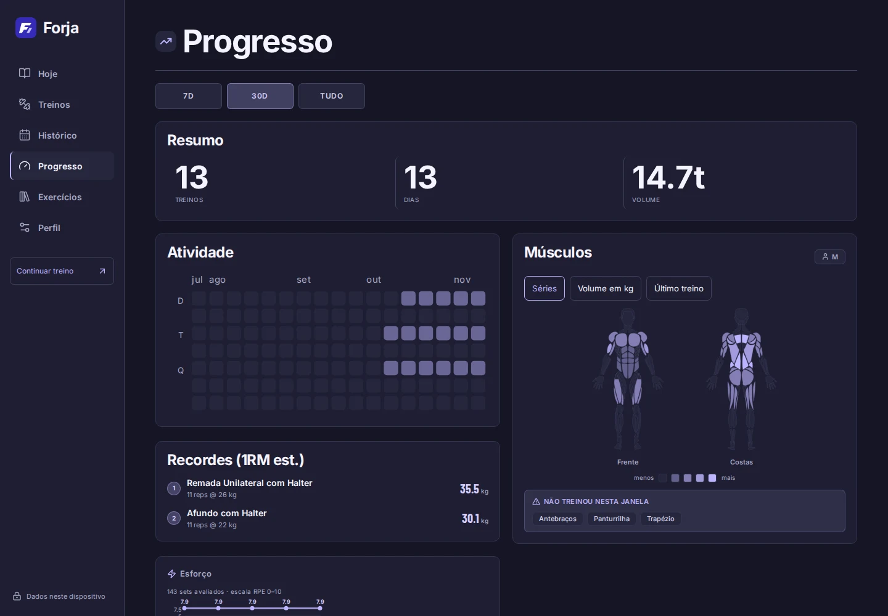

<p align="center">
  
</p>

<h1 align="center">Seu próximo treino começa aqui.</h1>

<p align="center">
  Planeje a semana, registre cada série e saiba o que tentar na próxima sessão.
  <br />
  Um diário de treino de força instalável, com seus dados no próprio dispositivo.
</p>

<p align="center">
  <a href="#telas">Ver o app</a> · <a href="#rodar-localmente">Rodar localmente</a> ·
  <a href="#instalar-como-app">Instalar como app</a> · <a href="#seus-dados">Fazer backup</a>
</p>

<a name="screenshots"></a>

## Telas

[](assets/screenshots/hoje-desktop.webp)

<table>
  <tr>
    <th scope="col">Hoje no celular</th>
    <th scope="col">Treino guiado no celular</th>
  </tr>
  <tr>
    <td><a href="assets/screenshots/hoje.webp"></a></td>
    <td><a href="assets/screenshots/treino-mobile.webp"></a></td>
  </tr>
</table>

<details>
  <summary><strong>Ver mais telas do desktop</strong></summary>
  <br />
  <table>
    <tr><th scope="col">Histórico</th><th scope="col">Progresso</th></tr>
    <tr>
      <td><a href="assets/screenshots/historico.webp"></a></td>
      <td><a href="assets/screenshots/progresso.webp"></a></td>
    </tr>
    <tr><th scope="col">Atlas de exercícios</th><th scope="col">Treino guiado</th></tr>
    <tr>
      <td><a href="assets/screenshots/atlas.webp"></a></td>
      <td><a href="assets/screenshots/treino-guiado.webp"></a></td>
    </tr>
  </table>
</details>

<sub>Capturas da aplicação com dados de demonstração.</sub>

## Do primeiro treino ao próximo

| Etapa | O que você faz na Forja |
| --- | --- |
| **Planejar** | Comece com um plano de força em casa, corpo inteiro, superior/inferior ou 5×5. Crie suas rotinas, distribua na semana e ajuste uma data quando precisar. |
| **Treinar** | Siga o roteiro e registre repetições, carga, tempo ou distância. Use cronômetros, superséries e aquecimentos. A sessão em andamento pode ser retomada no mesmo navegador. |
| **Evoluir** | Veja a próxima meta e o motivo. Compare o realizado com o planejado, corrija registros e acompanhe volume, recordes, esforço e medidas corporais. |
| **Encontrar exercícios** | Filtre pelo equipamento que você tem ou pelos músculos envolvidos. Consulte o atlas e as demonstrações disponíveis offline. |

Em **Treinos → Minhas rotinas**, o botão **Excluir plano** remove o conjunto criado a partir de um plano pronto. Use a lixeira de uma rotina para removê-la individualmente. Os agendamentos associados são retirados e as sessões já registradas continuam no Histórico.

<details>
  <summary><strong>Como funcionam as regras de progressão</strong></summary>

| Regra | Como a Forja calcula o próximo alvo |
| --- | --- |
| Manual | Usa o último registro como referência. |
| Linear | Sobe a carga após atingir o alvo e pode reduzi-la depois de falhas repetidas. |
| Greyskull LP | Usa as repetições da última série para decidir o incremento. |
| Dupla | Aumenta as repetições dentro da faixa antes de subir a carga. |
| Tempo | Ajusta a meta de duração dos exercícios cronometrados. |
| 5/3/1 | Prescreve séries por percentual e avança o máximo de treino ao concluir o ciclo. |

Aquecimentos ficam no Histórico, fora do cálculo de metas, volume e recordes. Cada sessão guarda o alvo que valia na hora do treino.

</details>

## Rodar localmente

Você precisa de **Git**, **Node.js 24** e **pnpm 12.16.1**. Se precisar instalar o pnpm, rode `npm install --global pnpm@12.16.1`.

```sh
git clone https://github.com/rfsants001/forja.git
cd forja
pnpm install --frozen-lockfile
pnpm dev
```

Abra **http://localhost:5577**. Em **Hoje**, selecione **Começar com um plano** para preparar o primeiro treino.

## Instalar como app

Para testar instalação e modo offline, use o build de produção.

```sh
pnpm build
pnpm --filter @forja/web preview --host 127.0.0.1 --port 4173 --strictPort
```

Abra **http://127.0.0.1:4173** e aguarde o carregamento inicial. No navegador compatível, use **Instalar aplicativo** ou **Adicionar à Tela de Início**. Em outro dispositivo, sirva o build por HTTPS para habilitar a PWA.

## Seus dados

Os registros ficam no IndexedDB do navegador. Em **Perfil → Seus dados**, exporte um backup JSON para guardar ou transferir seus treinos. Na restauração, revise a prévia e escolha mesclar os registros ou substituir os dados locais.

Você também pode importar CSVs de **FitNotes**, **Strong** e **Hevy**, importar peso de um XML do **Apple Health** ou compartilhar só o plano semanal em JSON ou PDF.

## Desenvolvimento e créditos

O domínio TypeScript vive em `packages/core`. A PWA React/Vite vive em `apps/web`. Rode `pnpm test`, `pnpm typecheck` e `pnpm build` antes de enviar uma alteração.

Forja é inspirada no [openGym](https://github.com/DuarteSantos8/openGym). A anatomia vem do [MuscleMap](https://github.com/melihcolpan/MuscleMap) sob MIT. As demonstrações usam imagens do wger e do Wikimedia Commons com [crédito e licença por arquivo](apps/web/public/exercise-media/CREDITS.md). A [documentação de integrações](.specs/codebase/INTEGRATIONS.md) registra as fontes e o status da licença do projeto.
