<h1 align="center">
  <a href="#screenshots">
    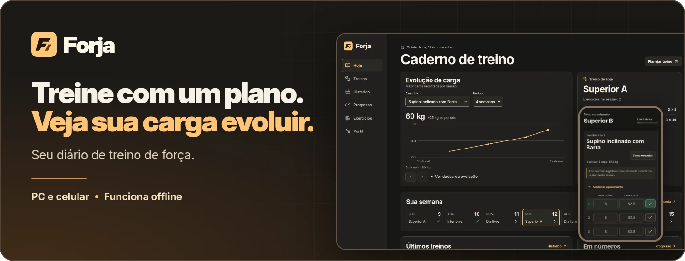
  </a>
</h1>

<p align="center">
  Build routines, log your sets, and track how much you can lift.
  <br />
  Install Forja from your browser. Sync your computer and phone through your own server.
</p>

<p align="center">
  <strong><a href="#screenshots">See Forja in action</a> · <a href="#run-locally">Run locally</a></strong>
  <br />
  <a href="#phone-quick-start">Phone guide</a> · <a href="#install-as-an-app">Install as an app</a> · <a href="#sync-desktop-and-mobile">Set up sync</a> · <a href="#your-data">Back up your data</a>
</p>

<a name="telas"></a>
<a name="capturas"></a>

## Screenshots

[](assets/screenshots/hoje-desktop.webp)

<table>
  <tr>
    <th scope="col">Today on mobile</th>
    <th scope="col">Guided workout on mobile</th>
    <th scope="col">History on mobile</th>
  </tr>
  <tr>
    <td><a href="assets/screenshots/hoje.webp"></a></td>
    <td><a href="assets/screenshots/treino-mobile.webp"></a></td>
    <td><a href="assets/screenshots/historico-mobile.webp"></a></td>
  </tr>
</table>

<details>
  <summary><strong>Explore more desktop screens</strong></summary>
  <br />
  <table>
    <tr><th scope="col">History</th><th scope="col">Progress</th></tr>
    <tr>
      <td><a href="assets/screenshots/historico.webp">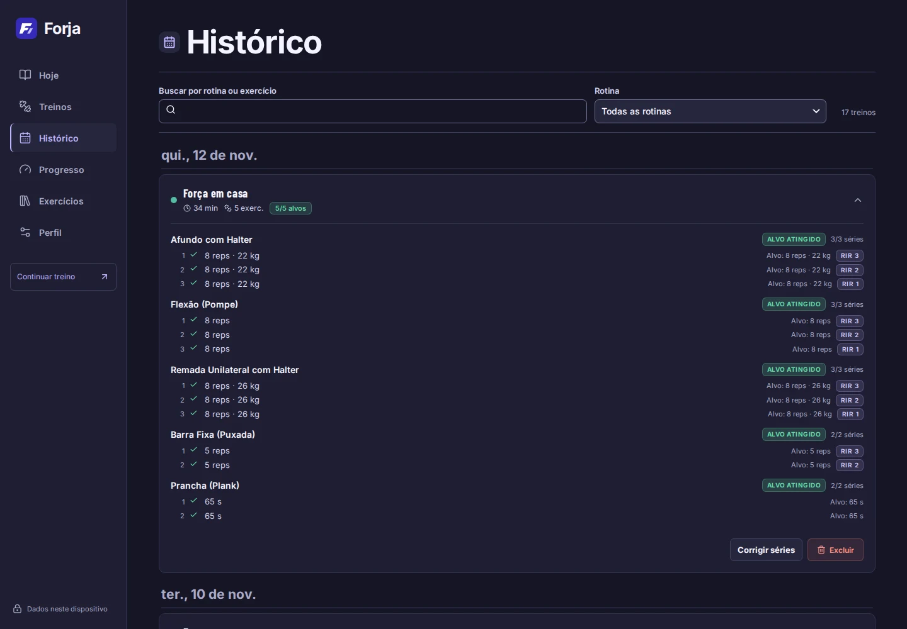</a></td>
      <td><a href="assets/screenshots/progresso.webp"></a></td>
    </tr>
    <tr><th scope="col">Exercise atlas</th><th scope="col">Guided workout</th></tr>
    <tr>
      <td><a href="assets/screenshots/atlas.webp"></a></td>
      <td><a href="assets/screenshots/treino-guiado.webp"></a></td>
    </tr>
  </table>
</details>

<details>
  <summary><strong>Explore sync, the Assistant, and load progression</strong></summary>
  <br />
  <table>
    <tr><th scope="col">Pairing on desktop</th><th scope="col">Devices on mobile</th></tr>
    <tr>
      <td><a href="assets/screenshots/dispositivos-desktop.webp">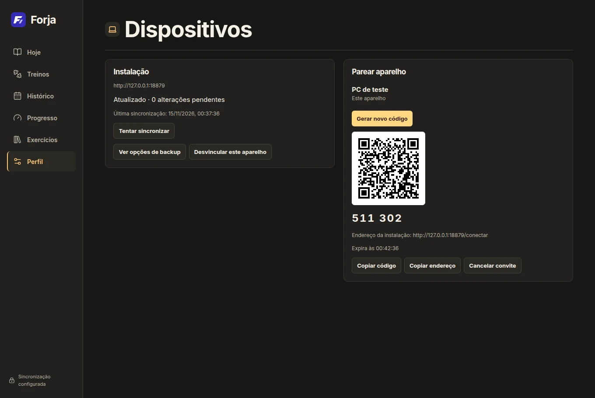</a></td>
      <td><a href="assets/screenshots/dispositivos-mobile.webp">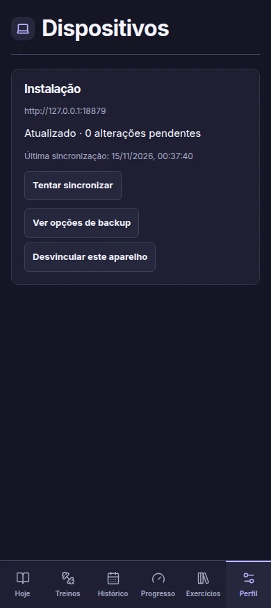</a></td>
    </tr>
    <tr><th scope="col">Weekly review</th><th scope="col">Load progression</th></tr>
    <tr>
      <td><a href="assets/screenshots/assistente-desktop.webp">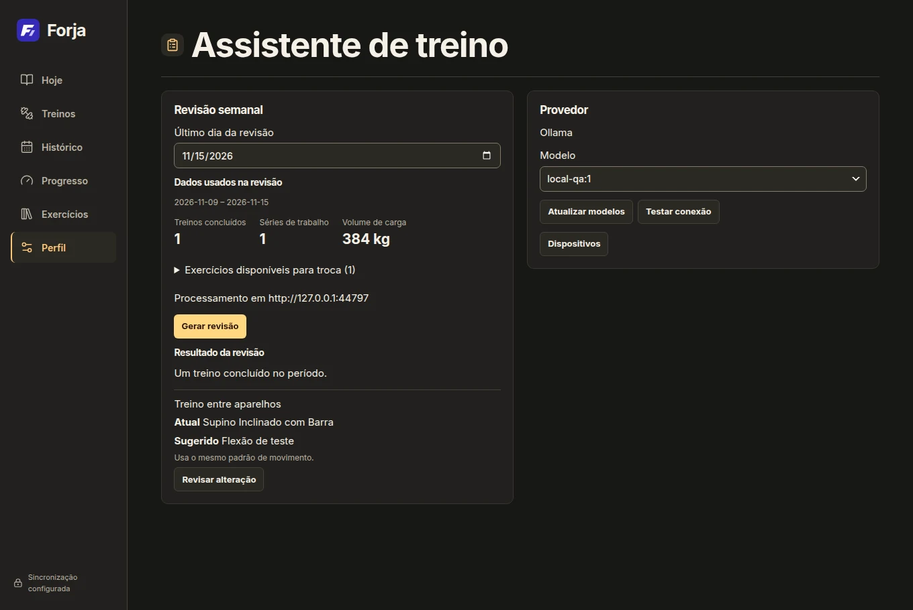</a></td>
      <td><a href="assets/screenshots/evolucao-desktop.webp">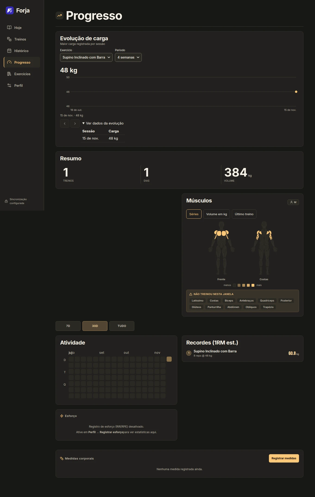</a></td>
    </tr>
  </table>
</details>

<details>
  <summary><strong>Explore onboarding and AI weekly planning</strong></summary>
  <br />
  <table>
    <tr><th scope="col">Desktop introduction</th><th scope="col">Mobile introduction</th></tr>
    <tr>
      <td><a href="assets/screenshots/boas-vindas-desktop.png">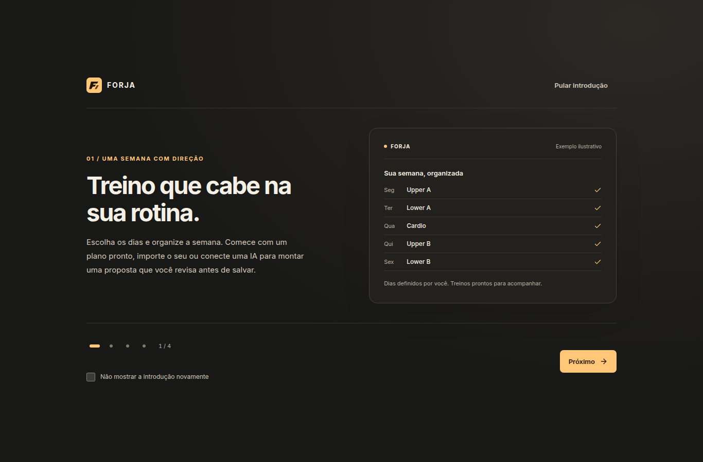</a></td>
      <td><a href="assets/screenshots/boas-vindas-mobile.png">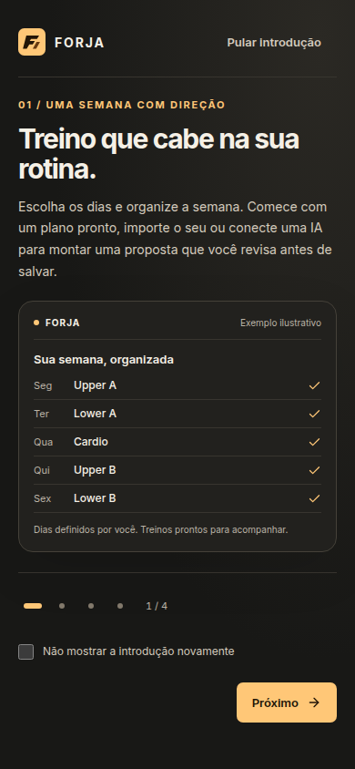</a></td>
    </tr>
  </table>

  [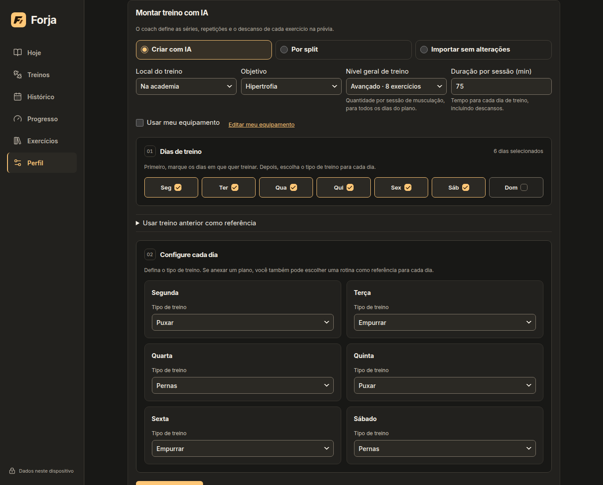](assets/screenshots/coach-dias-desktop.png)
</details>

<details>
  <summary><strong>Keep your plan: import JSON without AI on desktop and mobile</strong></summary>
  <br />
  <table>
    <tr><th scope="col">Desktop preview and scheduling</th><th scope="col">The same controls on mobile</th></tr>
    <tr>
      <td><a href="assets/screenshots/importar-json-desktop.png">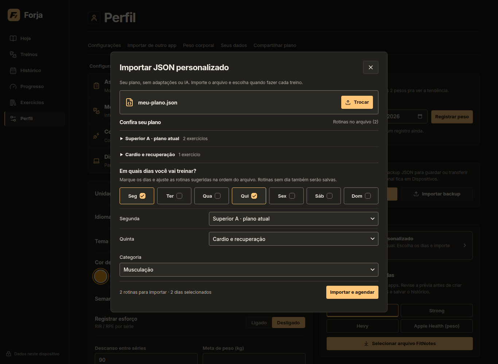</a></td>
      <td><a href="assets/screenshots/importar-json-mobile.png">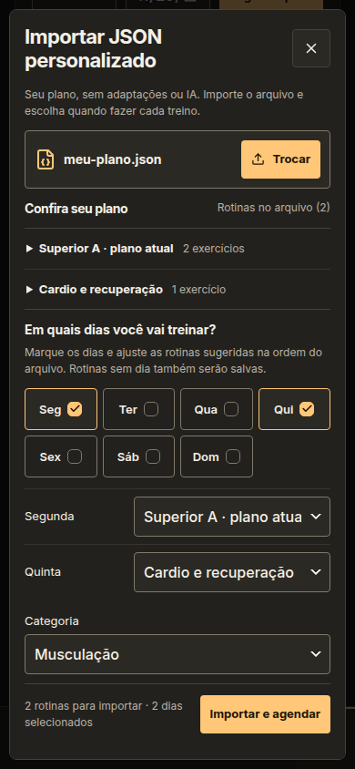</a></td>
    </tr>
  </table>
</details>

<sub>App screenshots use demonstration data. The Assistant screenshot uses a simulated provider.</sub>

<a name="do-primeiro-treino-ao-proximo"></a>

## From your first workout to the next

At startup, Forja prepares your local data and introduces the app in four slides. You can skip the introduction or select **Do not show the introduction again**. This preference is saved on the current device.

| Step | What you do in Forja |
| --- | --- |
| **Plan** | Start with a home strength, full body, upper/lower, or 5×5 plan. Build your routines, schedule them throughout the week, and adjust individual dates when needed. |
| **Train** | Follow the workout and log reps, weight, time, or distance. Use timers, supersets, and warm-up sets. In **Exercise guide**, view demonstrations, primary and secondary muscles, and YouTube search results for the exercise. |
| **Progress** | See your next target, the reasoning behind it, and load progression by exercise over 4 or 8 weeks. Track volume, records, effort, and body measurements. In **History**, filter by week or date range and expand a session to inspect its muscle map, sets, and warm-ups or correct your records. |
| **Find exercises** | Filter by your available equipment or the muscles involved. Browse the atlas and exercise demonstrations available offline. |

The default palette is **Amber**, with graphite and orange in dark mode and paper and orange in light mode. Change it under **Profile → Settings → Accent color**. During a workout, the rest timer keeps running while you consult the **Exercise guide**. Local guide resources work after the app has loaded. YouTube search opens a separate tab and uses your device's internet connection.

Under **Workouts → My routines**, **Delete plan** removes the group created from a starter plan. Use a routine's trash button to delete it individually. Associated schedule entries are removed, while completed sessions remain in History.

<details>
  <summary><strong>How progression rules work</strong></summary>

| Rule | How Forja calculates the next target |
| --- | --- |
| Manual | Uses your last record as a reference. |
| Linear | Increases weight after you meet the target and may reduce it after repeated misses. |
| Greyskull LP | Uses the reps in your final set to determine the increase. |
| Double progression | Increases reps within the prescribed range before increasing weight. |
| Time | Adjusts the duration target for timed exercises. |
| 5/3/1 | Prescribes sets using percentages and increases the training max after a completed cycle. |

Warm-up sets remain in History but do not count toward progression targets, volume, or records. Each session stores the target that applied when you trained.

</details>

<a name="rodar-localmente"></a>

## Run locally

You need **Git**, **Node.js 24**, and **pnpm 10.34.9** or **12.16.1**. To install the version used for clean-clone verification, run `npm install --global pnpm@10.34.9`.

```sh
git clone https://github.com/rfsants001/forja.git
cd forja
pnpm install --frozen-lockfile
npm start
```

Open **http://localhost:5577**. On **Today**, select **Start with a plan** to prepare your first workout. For development with automatic reloading, use `npm run dev` instead of `npm start`. Both commands run the app with the Assistant API.

<a name="instalar-como-app"></a>

## Install as an app

Run `npm start` and open **http://localhost:5577**. The command builds the app and starts the server. Once the app has loaded, choose **Install app** or **Add to Home Screen** in your browser. To use another device, serve your installation over HTTPS.

## Phone quick start

Start Forja with `npm start`. For the first phone connection, open your **reachable HTTPS installation** on both devices; `localhost` only works on the computer. Export a backup before moving existing data to a new address. See [network setup](#sync-desktop-and-mobile) for the server configuration.

<table>
  <tr><th scope="col">1 · Pair once (optional)</th><th scope="col">2 · Prepare your phone</th></tr>
  <tr>
    <td align="center"><a href="assets/screenshots/phone-guide-pair.png">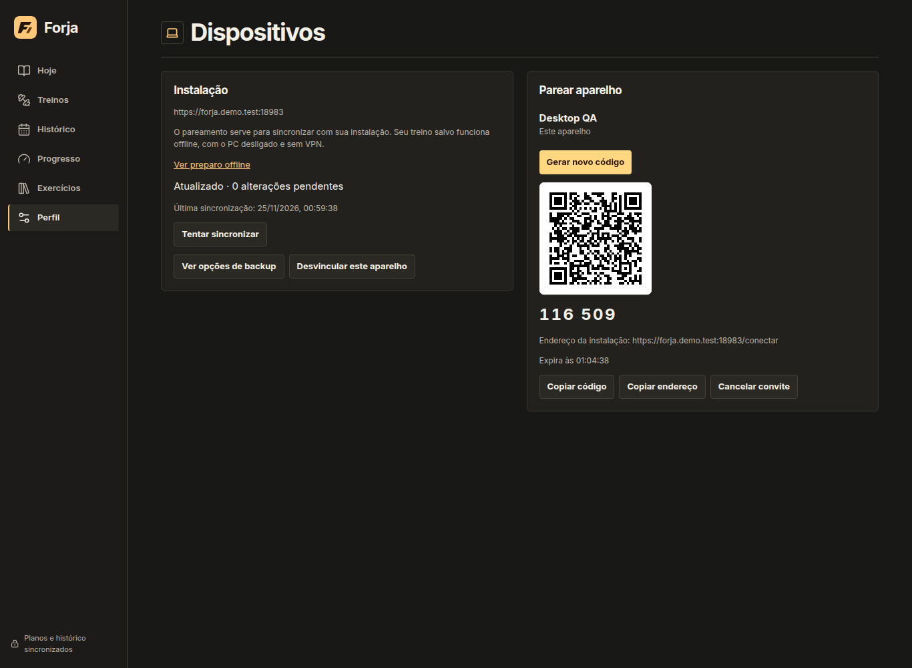</a></td>
    <td align="center"><a href="assets/screenshots/phone-guide-ready.png">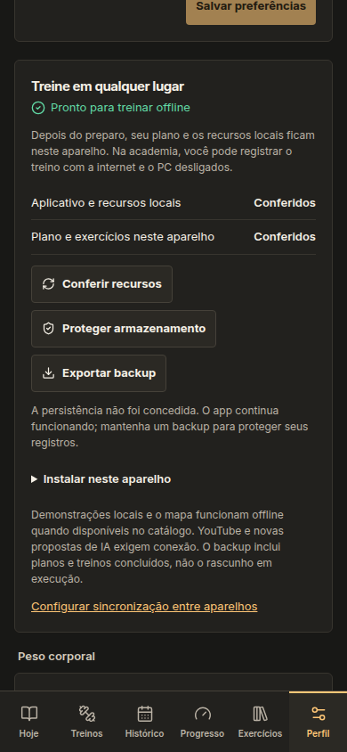</a></td>
  </tr>
  <tr>
    <td>To sync with your computer, open <strong>Profile → Devices</strong>, sign in as owner, and choose <strong>Pair a device</strong>. Scan the QR on your phone, approve the request on the computer, then review and confirm sync.</td>
    <td>Save or sync your plan. Open <strong>Profile → Train anywhere</strong> and wait for <strong>Ready to train offline</strong>. Install through your browser’s <strong>Install app</strong> or <strong>Add to Home Screen</strong> option.</td>
  </tr>
  <tr><th scope="col">3 · Train anywhere</th><th scope="col">4 · Sync when you reconnect</th></tr>
  <tr>
    <td align="center"><a href="assets/screenshots/phone-guide-workout.png">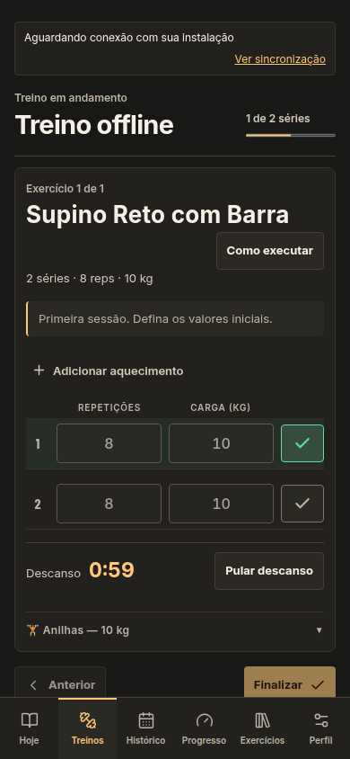</a></td>
    <td align="center"><a href="assets/screenshots/phone-guide-synced.png">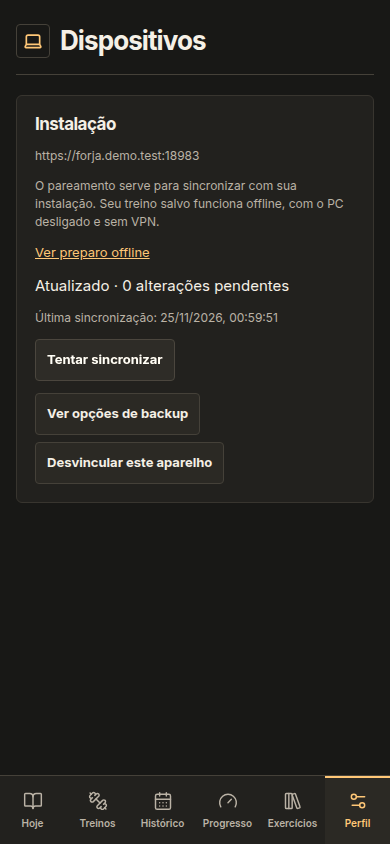</a></td>
  </tr>
  <tr>
    <td>At the gym, open your saved workout, log sets and finish—even with the internet and computer switched off. Your records stay on the phone.</td>
    <td>Open Forja when your server is reachable again. Pending changes sync automatically; check <strong>Profile → Devices</strong> for status or conflicts.</td>
  </tr>
</table>

<sub>Real app captures with demonstration data and an example address. Pairing is optional for offline training. ZeroTier or another VPN can provide remote access; trusted HTTPS is still required for initial mobile PWA setup.</sub>

## Train offline at the gym

Save your plan on the phone, then open **Profile → Train anywhere**. Forja checks the app files in Cache Storage and the plan's local exercise definitions before showing **Ready to train offline**. Keep the app open while the initial resources download. **Check resources** also repairs missing cached files when the original version is reachable.

Once prepared, open Forja at the gym with the internet and your computer switched off. Log sets, weights and rest, finish your workout, and reopen it in History. If the device is paired, changes wait locally until the app is open and can reach your server again. A VPN is optional for remote server access; it is not needed to execute a saved workout.

Use **Protect storage** to request persistent browser storage, and keep backups. The browser may decline the request. Clearing app data still removes local records. Backups include plans and completed workouts, not the active session. Storage failures show a warning and a retry action; keep the app open until your draft is saved successfully.

Updates require confirmation and wait until you finish or cancel an active workout. Local exercise demonstrations and the muscle atlas work offline when present in the catalog. YouTube and new AI proposals require a connection to their services. Initial mobile PWA setup still requires trusted HTTPS; native desktop installers remain planned.


<a name="sincronizar-pc-e-celular"></a>

## Sync desktop and mobile

The optional self-hosted installation serves the PWA and API from the same origin and stores synced data in SQLite. To try it on your computer, run:

```sh
pnpm install --frozen-lockfile
pnpm build
pnpm self-host
```

In another terminal, run `pnpm self-host:admin` to retrieve the owner key. Open **http://127.0.0.1:8787**, then go to **Profile → Devices → Sign in as owner**. Enter the key, compare both sides under **Review data**, and confirm sync.

For phone access, use a trusted HTTPS origin that both devices can reach through your network or VPN. Configure the address before installing the PWA. With an HTTPS proxy on the same computer, use a configuration like this:

```sh
FORJA_URL=https://forja.your-domain.example \
FORJA_HOST=127.0.0.1 FORJA_PORT=8787 \
FORJA_DATA_DIR=./data/forja FORJA_TIME_ZONE=America/Sao_Paulo \
pnpm self-host
```

Point the HTTPS proxy to `127.0.0.1:8787`. You can also serve TLS directly from the process using `FORJA_TLS_CERT` and `FORJA_TLS_KEY`. Use the same `FORJA_DATA_DIR` when retrieving the owner key. The configured address appears in the QR code.

1. On your computer, open **Devices → Pair a device**.
2. On your phone, scan the QR code with the camera or visit the displayed address and enter the code.
3. Approve the request on your computer, review the data on your phone, and confirm. Workouts completed offline are queued and uploaded when you reconnect. The Devices screen shows the latest sync, pending changes, and conflicts.

If you used Forja at another address, export a JSON backup there and import it into the new origin before syncing. Sync covers routines, the weekly schedule and date overrides, categories, referenced custom exercises, and completed workouts. Body measurements, body weight, preferences, personal library notes, and the active workout remain on each device.

To copy the entire installation, stop the server and copy the data directory, including the owner key and SQLite files. Keep the copy private. Restore it while the server is stopped, then check device connections after restarting. The review window uses `FORJA_TIME_ZONE` or the host's time zone.

<a name="assistente-local"></a>

<a name="assistente-de-treino"></a>

## Training Assistant

With Forja running through `npm start` or `npm run dev`, open **Profile → AI connections**. The Assistant runs on the computer hosting the server. **Devices** handles sync and remote access.

- **Ollama.** Keep Ollama running with a model installed. Select **Check Ollama**, choose a model, and click **Use in Assistant**. Forja detects the local service at `http://127.0.0.1:11434`. Administrators can set `FORJA_OLLAMA_URL` to use another endpoint.
- **Codex CLI.** Install the official CLI on Windows, macOS, or Linux and confirm that `codex --version` works in the terminal used to start Forja. One option available on all three platforms is `npm install -g @openai/codex`. On Linux, also install Bubblewrap. Under **Profile → AI connections**, select **Connect ChatGPT**, complete sign-in, then select **Use in Assistant**. [Codex installation](https://learn.chatgpt.com/docs/cli) · [Codex authentication](https://learn.chatgpt.com/docs/auth).
- **Claude Code.** The card shows availability. Anthropic restricts the use of subscription credentials by third-party applications. [Anthropic policy](https://code.claude.com/docs/en/legal-and-compliance#authentication-and-credential-use).

<a name="montar-um-treino-com-codex-por-assinatura"></a>

<a name="montar-um-treino"></a>

### Build a workout

Open **Workouts → Build a workout with AI**. Set the location, goal, **overall training level**, and **duration per session**. The level determines the number of strength exercises for every training day: **Beginner: 4**, **Intermediate: 6**, **Advanced: 8**. These counts are Forja settings; the AI still adapts sets, reps, and rest. Dedicated cardio days retain their timed block. The coach proposes sets, reps, and rest. Before displaying a result, Forja checks estimated duration, exercise order, and suitability for the goal. **How Forja built this workout** explains the progression and the basis for the choices. [ACSM resistance training position stand](https://acsm.org/resistance-training-guidelines-update-2026/).

In **Create with AI**, select your training days first, then choose the workout type for each day. Attaching JSON is optional and preserves the days and types you have already selected. When a plan is attached, each day's controls also let you choose a reference routine. In **By split**, select a split and your days; the preview shows the schedule before generation.

Your time setting applies to **each individual session**: 60 minutes across six days means up to 60 minutes on each day. If the exercises and rest periods for your level do not fit, or your equipment does not provide enough compatible options, Forja explains the limitation. Adjust the duration, level, or inventory. **Import unchanged** preserves the file's content and lets you schedule its routines on your chosen days. When generating from a reference, the preview compares exercise and set counts before and after, and lists examples not covered by the eligible catalog. The comparison is saved in the routine's note. Selection avoids translated duplicates and excessive calf or wrist exercises; duration estimates include both sides of explicitly unilateral exercises and rest between exercises.

Under **Use a previous workout as reference**, choose a History session, a Hevy, Strong, or FitNotes CSV, a Forja JSON file, or **External plan (CSV or JSON)**. The preview shows up to 40 sessions or routines. Files are read in your browser. During generation, AI receives only the selected summary, including exercises, sets, reps, time, and weight when available. To add completed sessions to History, use the CSV options under **Profile → Import from another app**. To continue a program without AI, select **Import custom JSON** in the same section.

**External plan** accepts OpenGym plan JSON (`opengym_plan: 1`). You can also prepare a CSV using the supported column names `treino,exercicio,series,repeticoes,segundos,carga_kg`, or JSON containing `routines` with an `exercises` list for each routine. Only `exercicio` and `series` are required in that CSV format. In JSON, each exercise requires `name` and `sets`; `reps`, `seconds`, and `loadKg` are optional. A single-routine file can look like this:

```json
{"routines":[{"name":"Full body","exercises":[{"name":"Squat","sets":3,"reps":"8–12"}]}]}
```

Register your inventory under **Profile → My equipment** or through the link in the Assistant. Enter the type, quantity, and weight per item when applicable. Register four 5 kg plates and two 10 kg plates on separate rows. The inventory supports treadmills, stationary bikes, ellipticals, and rowing machines. AI uses your equipment and quantities to select home exercise variations. A barbell bench press requires a straight bar, a bench, and a rack. The home catalog includes dumbbell, EZ bar, pull-up bar, and plate variations, with floor or standing options when no bench is available. Standard, hammer, and reverse curls, for example, are recognized as distinct exercises. Available dumbbell quantities are also respected. Adjustable dumbbell handles can include a description in parentheses and must be registered alongside your plates; push-up handles are also recognized. The equipment list shows the type used by the Assistant. Preparatory drills do not fill the plan's working-exercise quota.

The **Weight loss** goal shows your latest recorded body weight and the target weight from Profile. When both are filled in, the provider receives them during generation. Sessions combine strength training with moderate cardio within the total duration. Cardio choices account for available equipment and include walking without a machine. [Physical activity and weight (CDC)](https://www.cdc.gov/healthy-weight-growth/physical-activity/).

For gym workouts, the preview offers alternatives using another form of resistance when the library contains a variation from the same movement family, such as a dumbbell, machine, or cable fly. Alternatives are saved in the routine's notes. During weekly reviews, Forja sends aggregates and replacement candidates. Changes require confirmation and can be undone while the applied version is still current.

Sign-in is stored in a dedicated Codex profile on the host. The server uses the provider and model selected in the UI. Advanced installations can still specify absolute paths through `FORJA_CODEX_BINARY` and `FORJA_CODEX_HOME`. Run `pnpm self-host:codex-probe` to test the dedicated profile with fictional data.

Forja uses an isolated Codex profile on every system. On Linux, it uses Bubblewrap and system certificates. On Windows and macOS, it runs the native binary with CLI restrictions. On Windows, Forja locates the executable associated with the npm installation and also accepts the path to `codex.exe` through `FORJA_CODEX_BINARY`. Device-code sign-in is available when enabled for the account. For a proxy using a custom CA, the CLI accepts `CODEX_CA_CERTIFICATE` pointing to the PEM certificate configured on the host. [Codex authentication documentation](https://learn.chatgpt.com/docs/auth#custom-ca-bundles).

<a name="usar-uma-api-de-ia-compativel"></a>

### Use a compatible AI API

Set `FORJA_COMPAT_URL` to the base URL ending in `/v1` or its equivalent, and `FORJA_COMPAT_MODEL` to the model ID. If the API requires a key, set `FORJA_COMPAT_API_KEY` in the server environment. On macOS and Linux, use `export NAME=value`. In PowerShell, use `$env:NAME = "value"`. Start Forja, open **AI connections → OpenAI-compatible API**, and select **Use in Assistant**.

Example URLs include `https://api.openai.com/v1`, `https://generativelanguage.googleapis.com/v1beta/openai/` for Gemini, and `http://127.0.0.1:1234/v1` for LM Studio. The API must accept Chat Completions and return JSON text. The destination is shown before generation. [Gemini compatibility](https://ai.google.dev/gemini-api/docs/openai) · [LM Studio compatibility](https://lmstudio.ai/docs/developer/openai-compat).

<a name="importar-e-distribuir-um-plano-na-semana"></a>

### Import and schedule a weekly plan

In **Build a workout with AI → Create with AI**, attaching a file is optional. To start from scratch, select **Create workout** for your chosen days and set each session's type. To use a previous plan, attach its JSON and select reference routines. Assign a file routine and workout type, such as upper, lower, push, pull, legs, or cardio, to each training day. Review the week before saving. **By split** builds a schedule from your chosen pattern. With **Upper / Lower + Cardio**, five days from Monday through Friday produce Upper A, Lower A, Cardio, Upper B, and Lower B. Forja compares sessions with the same role and varies compatible exercise selections. If your inventory limits substitutions, the preview explains the limitation and the app varies the prescription within your goal. Dedicated cardio days are assembled locally.

To continue your existing program, open **Profile → Import from another app → Import custom JSON**. The dialog explains accepted fields, displays an example, and lets you download it. [Download an example JSON file](assets/examples/plano-personalizado.json).

The same flow is available under **Assistant → Import unchanged**. Load a Forja, OpenGym, or portable JSON file in the format above. Review exercises in the preview, select your days, and adjust each day's routine. Suggestions follow file order and are saved only after **Import and schedule**. Import runs locally and preserves prescriptions in supported fields. Unscheduled routines also appear in **Workouts**. Each day supports one routine; replacing an occupied day requires confirmation. History and the active workout are preserved. Unknown fields are not imported; use `note` for additional guidance. Weight (`loadKg`), rest (`restSec`), time (`seconds`/`secondsMax`), distance (`targetDistanceM`), and speed (`targetSpeedKmh`) retain their units. This flow works without configuring AI or a server.

Repeated-session comparisons apply to every available split.

| Split | Example schedule |
| --- | --- |
| Upper / Lower | Upper A, Lower A, Upper B, Lower B |
| Upper / Lower + Cardio | Upper A, Lower A, Cardio, Upper B, Lower B |
| Full body | Full body A, Full body B, Full body C |
| Push / Pull / Legs | Push A, Pull A, Legs A, Push B, Pull B, Legs B |

A [desktop app with an integrated PWA server and a phone QR code](.specs/features/desktop-pwa/spec.md) is planned.

<a name="seus-dados"></a>

## Your data

Local records are stored in your browser's IndexedDB. Under **Profile → Your data**, export a JSON backup to keep a copy or transfer your workouts. During restoration, review the preview and choose whether to merge records or replace local data.

You can also import **FitNotes**, **Strong**, and **Hevy** CSV files, import body weight from **Apple Health** XML, or share just your weekly plan as JSON or PDF.

<a name="desenvolvimento-e-créditos"></a>

## Development and credits

The TypeScript domain lives in `packages/core`. The React/Vite PWA lives in `apps/web`. The optional Node.js 24 and SQLite server lives in `apps/server`. Run `pnpm test`, `pnpm typecheck`, and `pnpm build` before submitting a change.

For the production offline regression, install a test browser once with `pnpm exec playwright install chromium`, then run `pnpm test:offline`. The test uses temporary data, two isolated browser contexts, and a real server. It covers server shutdown, offline reopening and workout completion, storage failure/retry, reconnect without duplicate sessions, and update protection across tabs. Use `PLAYWRIGHT_EXECUTABLE_PATH` for an existing Chromium browser and `FORJA_QA_ARTIFACTS` to save screenshots. Physical Android/iOS and desktop acceptance checks are still required.

Forja is inspired by [openGym](https://github.com/DuarteSantos8/openGym). Anatomy comes from [MuscleMap](https://github.com/melihcolpan/MuscleMap) under MIT. Exercise demonstrations use wger and Wikimedia Commons images with [per-file attribution and licensing](apps/web/public/exercise-media/CREDITS.md). The [integrations documentation](.specs/codebase/INTEGRATIONS.md) records sources and the project's license status.
